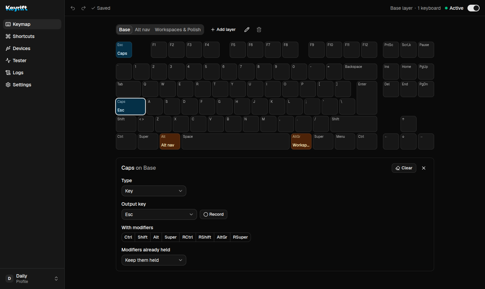

<div align="center">


# Keyrift

**A keyboard remapper for Linux with a visual editor.**

Layers, tap-hold keys, shortcuts and macros, edited by clicking an on-screen keyboard
instead of writing a config language.

[](https://github.com/lukmiik/keyrift/actions/workflows/ci.yml)


[Install](#install) · [Features](#features) · [Command line](#command-line) · [Development](#development)

</div>

<br>

<p align="center">
  
</p>

## About

Keyrift has two parts. The **engine** is a small Rust program that runs in the background as a systemd
user service: it takes over your keyboards, remaps every key press and sends the result to the system
through a virtual keyboard. The **app** is where you edit the keymap: click a key, choose what it should
do, and the engine applies the change the moment it is saved.

It is built to be dependable. It never runs as root, it never leaves a key stuck down, it survives
unplugging keyboards and suspending the computer, and it starts when you log in. Your keymap is plain
JSON in `~/.config/keyrift/`, so it can live in your dotfiles.

If you use [kanata](https://github.com/jtroo/kanata), [keyd](https://github.com/rvaiya/keyd) or
[xremap](https://github.com/xremap/xremap) and would rather point and click than edit a config file,
Keyrift is meant for you.

## Features

### Remapping

- **Any key to any key**, with or without modifiers: Caps Lock to Escape, AltGr+A to `ą`,
  Super+C to Ctrl+Shift+C. Every Linux key code works, including F13–F24, media and numpad keys.
- **Layers.** Hold a key to switch on another layer, toggle one on and off, or hold a layer together
  with modifiers. Keys a layer leaves empty fall through to the layer below.
- **Tap-hold.** One key, two jobs: tap for one action, hold for another (for example tap for Escape,
  hold for Ctrl). The timeout and the decision strategy can be set globally or per key.
- **Shortcuts.** Turn one key combination into another, such as Super+C into Ctrl+Shift+C, or switch
  one off entirely.
- **Macros.** A sequence of keys and pauses, typed with one press. Steps can be picked or recorded.
- **Profiles.** Keep several complete keymaps and switch between them from the sidebar. Export a
  profile to a file and import it on another computer.

### The app

- **Visual keyboard** that shows what every key does on the selected layer. Click a key to edit it.
- **Record** a key from your physical keyboard instead of looking it up in a list.
- **Tester** that shows each key press live: which keyboard sent it, what it was remapped to and
  which layers were active.
- **Devices** screen to choose which keyboards are remapped. Mice that pretend to be keyboards are
  detected and left alone.
- **Logs** from the engine with a level filter, and **Settings** for autostart, theme, layout and
  layer notifications.
- **Tray icon** that shows whether remapping is active and which layers are on, with a notification
  when a toggle layer changes.
- **Setup wizard** that checks permissions, groups, the uinput module and competing remappers, and
  fixes what it can with a single password prompt.
- **Updates** from Settings: check, download and install a new version without leaving the app.
- Undo and redo, autosave, and a light and dark theme.

### The engine

- Runs as your user, never as root. Access comes from a udev rule and the `input` and `uinput` groups.
- Hot-plug: a keyboard plugged in later is picked up within a second.
- Suspend and resume without a restart and without stuck keys.
- Live reload: edit the JSON by hand and the engine picks up valid changes immediately.
- Pause and resume at any time from the app, the tray or the command line.
- **Emergency release:** hold Left Ctrl + Space + Esc together and the engine lets go of every
  keyboard at once. Resume from the app, the tray or `keyrift resume`.

## Install

Keyrift needs **Linux on x86_64 with an X11 session**. Wayland is not supported yet.

Download the package for your distribution from the
[latest release](https://github.com/lukmiik/keyrift/releases/latest):

| Distribution               | File                                  | Install                                      |
| -------------------------- | ------------------------------------- | -------------------------------------------- |
| Debian, Ubuntu, Mint       | `keyrift_<version>_amd64.deb`         | `sudo apt install ./keyrift_*_amd64.deb`     |
| Arch, Omarchy, Manjaro     | `keyrift-<version>-x86_64.pkg.tar.xz` | `sudo pacman -U keyrift-*-x86_64.pkg.tar.xz` |
| Any other (no root needed) | `Keyrift-<version>.AppImage`          | `chmod +x Keyrift-*.AppImage`, then run it   |

The `.deb` and pacman packages install the app to `/opt/Keyrift`, the engine as `/usr/bin/keyrift`,
and the udev rule and module settings the engine needs. The AppImage needs no root to install: it
copies its engine to `~/.local/share/keyrift/bin` and keeps it up to date there, and the setup
wizard does the system part with one password prompt.

### Updating

Open **Settings → Updates** and click **Check for updates**. Keyrift downloads the new version from
GitHub, installs it (the packages ask for your password once) and restarts. Your keymaps stay.
Version 0.1.0 can't update itself yet: install 0.2.0 by hand once, as above.

### First start

1. Open **Keyrift** from your application menu.
2. The **setup wizard** checks your system. Click **Fix with one password prompt** if it reports
   missing groups or permissions, then log out and back in so the new groups take effect.
3. Click **Install the engine service**. The engine now runs in the background and starts at login.
4. Press any key in the wizard to confirm the engine receives it.

If another remapper such as kanata is running, the wizard says so: stop and disable it first, as
two remappers cannot hold the same keyboard.

### Uninstall

```sh
keyrift service uninstall          # stop and remove the engine service
sudo apt remove keyrift            # or: sudo pacman -R keyrift
```

Your keymaps stay in `~/.config/keyrift/` until you delete that folder.

## Configuration

Everything lives in `~/.config/keyrift/`:

```
settings.json          # active profile, excluded keyboards, tap-hold defaults, app settings
profiles/daily.json    # one file per profile: layers, keys, shortcuts
```

The files are validated against a JSON Schema by both the app and the engine, and a broken file never
replaces a working keymap. [`examples/config`](examples/config) has a complete profile with two extra
layers, and the schemas in [`packages/config-types/schema`](packages/config-types/schema) describe
every field.

## Command line

The engine is also a command-line tool:

```sh
keyrift status                # state, profile, active layers, errors
keyrift devices               # keyboards and whether they are remapped
keyrift pause                 # release all keyboards until keyrift resume
keyrift reload                # read the config again
keyrift validate <file>       # check a profile or settings file
keyrift log-level debug       # change the log level while running
keyrift monitor               # live key events in the terminal
keyrift service install       # install and start the systemd user service
```

Logs go to the journal: `journalctl --user -u keyrift.service -f`.

## Development

The repository is a Cargo workspace for the engine and a pnpm workspace for the app, which uses
[Vite+](https://viteplus.dev/) (`vp`).

```
crates/core      pure remapping logic, no I/O
crates/config    config types and JSON Schema
crates/engine    the daemon: evdev, uinput, hot-plug, IPC
crates/cli       the keyrift binary
apps/desktop     the Electron + React app
packaging/       udev rule, systemd unit, package scripts
```

You need Rust (the version is pinned in `rust-toolchain.toml`), Node.js and Vite+. Then:

```sh
vp install                               # JavaScript dependencies
cargo build --workspace --all-targets    # engine and test helpers
cd apps/desktop && vp dev                # run the app against the keyrift on your PATH
```

Checks, also run by CI on every push:

```sh
cargo fmt-check && cargo lint && cargo test --workspace
vp check && vp test
```

The end-to-end tests create virtual keyboards through `/dev/uinput` and run their own private engine,
so they never touch your real keyboards or your running service. Without access to `/dev/uinput`
they skip themselves.

To build the packages locally, run `vp run package` in `apps/desktop`; see
[`packaging/README.md`](packaging/README.md). Pushing a `v*` tag builds them on GitHub and attaches them
to a release.
